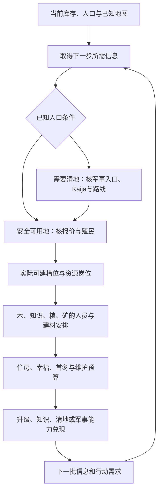

# 运营助手设计：把视野、人口与投入排成下一段行动

状态：设计草案，尚未接入局内推荐。当前采集器、条件预算比较器和这里提出的规划器有各自边界；本文不是固定开局表、自动玩家或最优策略认证。规则绑定当前已核PC版本，具体机制见[资料入口](MECHANICS_REFERENCE.zh-CN.md)。

目标是回答玩家四个实际问题：现在先做什么；为什么现在做；会占用哪些人和资源；看到什么新信息后应改变计划。没有预先选择终局胜利方式，也应能检查开局信息、住房、有效岗位、首冬和近期能力的衔接。

## 1. 玩家看到的是行动及其后续，而非资源排行榜

每次主要展示一项建议和最多两个有实际区别的替代方案。每张卡包含：

| 部分 | 内容 |
|---|---|
| 当前行动 | 侦察某方向、补房、派人、殖民候选、预留升级材料等；对象必须与已知信息相容 |
| 触发原因 | 下一人口临近、关键资源入口未找到、目前没有可用接敌路线、某笔建设会挤占升级预算等 |
| 完整下一段 | 前置信息/清地→支付→建造→指派→到岗→岗位或能力生效；已完成环节不重复安排 |
| 原币种预算 | 粮、木、金、石、铁、知识分别列出支付与预留时点；不统一换成分数 |
| 人口安排 | 谁离开原岗、施工和移动阶段、哪份产出暂时减少、新出生者计划去哪里 |
| 时间与风险 | 可计算的期限/区间、到时仍缺什么、是否挤占冬粮/现金/其他计划；未知不填精确秒数 |
| 改变计划的条件 | 新发现另一资源地、入口被挡、队友未按时完成侦察、出现威胁、关键加成/报价变化 |
| 证据 | 实际观测、代码规则、条件计算、经验假说分别标记；缺少何种输入明确列出 |

例如“准备市政厅升级”应显示100木、50金、10石的组合、未满足条件及竞争开支。它不是“石够了就继续挖”或“木少就多造木场”。新木场必须接到合法场址、增派的有效工人及其原岗位代价。

## 2. 视野是行动前置，也是一项持续任务

开图影响可选地块、清野路线、建设布局、替代矿源、防守准备和军队能否到达。不能因为眼前没有直接库存收入，就将侦察判为无效；不能因为有队友或某氏族擅长侦察，就默认相关方向已被探明。

按游戏阶段维护待解问题，而非只显示探索百分比：

| 阶段 | 信息任务示例 | 完成依据 |
|---|---|---|
| 开局 | 周边知识/粮/木入口、需要何种清地能力、扩张方向 | 对下一轮选择有用的已知资源与入口条件，不能仅凭一环计数宣称开完 |
| 继续发育 | 后续矿/粮替代、可用海岸和槽位、下一块地的成本与通路 | 相应候选被实际识别并能说明前置；未知仍保留 |
| 队伍行动 | 与队友连接、约定方向是否真正开出、支援是否可达 | 实际取得的信息；职责声明作为计划，不替代完成证据 |
| 进攻/防守准备 | 接敌路线、必要侦察能力和新近可见威胁 | 到行动期限前的路线/能力证据；旧信息不自动当当前安全 |

每项信息任务记录问题、使用期限、已知范围、责任声明、实际获得信息和失败后的应对。可以把一名侦察员换回经济，但要说明剩下的未解问题由谁、何时解决；不默认长期停止开图，也不强制每局始终保留同样人数。

### 两类“未知”必须分开

1. **玩家未探明：**候选中可以包括侦察、调整方向或等待明确的队友交付；得到新信息后再决定殖民/清地。
2. **玩家已知、采集器缺字段：**这是数据接入缺口。应补读取或使用明确标源的本地确认，不能错误地让玩家重复侦察已知地。

事实至少区分`known_to_player`、`visible_now`、`last_observed_game_time`、`observation_source`和`collector_support`。历史已发现不是当前可见；某方向信息缺失，不等于该方向没有资源或危险。共享信息来源未知时仍可使用已经取得的内容，但不归功于某个侦察员。

当前组件只覆盖部分已知地图几何，未完整采到未殖民地资源、中立阻挡、当前可见和探索进度。不得用全图真值、种子逆推或殖民后的资源事实填充之前的未知。详见[现有环层边界](BASE_NEIGHBORHOOD.md)。

## 3. 开局是一张带地图分支的能力依赖图

第一版优先研究普通熊族单人开局，以玩家已确认的“侦察营、双侦察、军事入口/Kaija、资源入口、木与知识”作为可编辑教学模板，逐项写明适用条件。它不是所有地图强制的固定顺序。

比较一块知识地、一块粮地或另一条路线，应从当时已知的内容出发：

- 能否按需要的时间获得并真正派人使用；是否要先清地、移动或取得其他能力。
- 殖民粮是否挤掉召熊、住房施工期间的粮流、盛宴与首冬缓冲。
- 取地后的建筑、工人、维护和后续升级能否配套；土地资源不按取得时刻立刻计为产出。
- 是否保留后续海岸、住房、粮食和军事设施的位置；安全、通路与空间不能由几何距离替代。
- 是否让后续几个月陷入只有一种资源入口、没有替代路线的局面。

已知安全知识地与被挡知识地会生成不同链条；临冬仍无可靠粮源与已有稳定粮源也会改变优先序。此时无需先向新玩家追问永久战略目标，系统可提出有条件的阶段里程碑。

## 4. 同时维护信息、劳力、资源和能力期限

规划状态包括：游戏时钟/季节；人口、幸福和增长进度；每个人的任务与过渡阶段；各币种库存和汇总流；建筑/升级/岗位；合法知识及下一点成本；已知地图、未解信息任务与队伍声明。

近期细算下一到两游戏月，同时保留首冬、市政厅、视野/出兵等较长期限的材料和能力预算。临近季节、出生、完成、知识、矿尽和任务变化时必须分段；收到新信息后滚动重算。

| 账本 | 需要检查什么 |
|---|---|
| 信息 | 本方案依赖哪些事实，玩家是否已知，是否过期；先获取哪项信息能改变分支 |
| 劳力 | 同一个人不能同时采食、施工、挖矿、侦察；移动/转职有先后，到岗不自动等于已结算 |
| 材料与维护 | 每笔支付何时发生，未来收入何时可用，预留给哪个能力；不能只看期末余额 |
| 人口供给 | 当前进度、幸福与容量何时可能形成新人；出生后重算食耗、幸福和下一门槛 |
| 能力 | 建造、知识、矿物、军队和视野何时一起满足用途；有铁、有石或有军队都不自动代表目标已达成 |

原币种存量按适用分支计算：连续产耗积分、离散付款、上限、库存/资源刷新顺序分别处理。未知逐人产出或路程不能伪装成零或精确预测。普通矿物按共享进度和离散到账核算，不直接将配置q当库存率。

材料预留按支付期限计算，不能机械地把100木永远锁在库存里。若在声明的工人/季节/维护条件下，后续收入能及时补齐，前面的建设可以兼容升级；若到时补不齐，就显示缺口和延期。某项建设扣材料后的静态余额只是一条预警，不能代替完整时间账，也不能把分期付得起的项目误报为同时破产。

一个候选应包含完整可执行的小链，另允许信息分支，例如“先探明方向；若知识入口可用则上知识，否则先建立已知粮/木入口并继续开图”。在未知地块上预先排定全年最优顺序不属于本阶段能力。

## 5. 怎样比较方案

按以下顺序比较，保留无法直接互换的收益：

1. **信息与合法性：**依赖玩家未知事实的确定计划不进入可立即执行候选。字段缺失按候选隔离，不能让整个助手停摆。
2. **紧迫问题：**已知威胁、即将触发的住房/幸福阻塞、支付与维持能力风险先呈现；未知威胁不当作零威胁。预算底线属于可解释的计划约束，玩家可以选择承担风险，不是游戏规则或强制封锁操作。
3. **能力期限：**谁能按时形成所需岗位、知识、升级、通路或军力；同时展示延期和替代能力。
4. **可比方案的代价：**若同样满足期限和信息要求，比较原币种费用、劳动占用、风险与后续转向空间；一方各项不差且至少一项更好时才可以淘汰另一方。
5. **不能直接排序时：**显示少数真正有区别的路线与交换条件，如“早升级，暂缓第二田”和“先第二田，接受升级推迟”。不强行造一个粮木金知识的统一分数。

固定“缺口相同时优先最少工人/暂缓”的规则不能独立决定侦察、清地或队伍支援；它会漏掉改变可行路线的信息和外部收益。

## 6. 建筑布局也进入规划

场址检查资源/海岸要求、有效容量、计入槽位的建筑、实际摆放、路径、安全与后续用途。当前`base_building_slots`来自基础字段，不保证等于UI最终容量；自然对象/装饰物也不按普通建筑计槽，不能用建筑数组长度判断满地。

第一座房放家里要结合下次人口期限与后续场址：可能及时保住增长，也可能占用稀缺的海岸发展位置。缺有效槽位和合法场址时，不给“必须搬房”或“必须另殖民”这种唯一结论。新增木场同样要检查是岗位容量不足还是没有更多合适工人，空场不增加木材。

## 7. 实现边界与已有代码

`companion/core/recommender.py`目前是外部提供输入的分段预算比较器：显式给定币种目标、流速、季节、工人和合法性，它能比较条件余额；它不识别地图、不推演人口/战斗/路径，也未模拟所有上限和任务。保留它作限定条件的预算组件，不将其名称等同于完整运营助手。

拟分成五个模块，字段与名字为设计契约，尚非已发布API：

1. **局面与证据适配：**保留当前事实、时钟、缺口、适用域和信息来源。
2. **阶段模板与候选生成：**按氏族、地图、已有能力和队伍声明生成小链；不要求先指定永久胜利方式。
3. **事件预算与可行性：**联合计算支付、劳力、出生、季节、槽位和已知前置，返回条件范围及失败原因。
4. **方案比较与解释：**呈现建议/替代/翻转条件，大模型解释结构化证据，不自行编价格、加成、视野事实或精确收益。
5. **结果追踪：**实际完成、支付、到岗、出生后核预测；建议被忽略、玩家改变计划、外部变化和模型失误分别记录。

## 8. 分期交付与验收

| 阶段 | 可交付内容 | 验收重点 |
|---|---|---|
| A：既有记录离线验证 | 住房期限、已声明材料承诺、调岗局部产耗、现金来源、视野缺口的决策卡 | 只用当时及之前的状态；不能偷看后来地块或结果；未知输入不能变成确定建议 |
| B：本人已知地图接入 | 已探索资源/当前可见/最后看见、侦察任务进度、有效槽位与本地合法性 | 来源与范围核验、读取失败隔离、本人短测；不能直接遍历隐藏全图或他方动态对象补数据 |
| C：熊族短链比较 | 开图/清地→殖民→建筑→到岗，与住房/首冬/升级预算联动 | 建造付款/完成/有效工作分别对账，预测在未用于拟合窗口复核；仅对支持的链给推荐 |
| D：共同对局协作 | 声明谁负责哪项信息/清地、实际是否交付；共享信息利用与失败后重排 | 独立自愿视角与真实3v3验证；队伍声明不覆盖原生事实，也不扩读其他玩家经济 |

结构性反例必须包括：地图未探明仍给定殖民地点；玩家已知而采集器缺字段却叫重复探索；队友存在被当作视野充分；第二房晚完工；第二田/矿挤占升级木材；冬季两粮工转矿；空木场被计为新增产量；有矿却无现金兑现；基础槽位被当最终容量。

阶段B已有第一项正式实现：[已探索地块详情](KNOWN_ZONE_DETAILS.zh-CN.md)在原生对局类型明确为空或Standard的普通单人FFA中后台读取限定自然资源、石铁余量／进度与无玩家归属狼熊，接入逐帧投影、健康诊断、严格贡献验证和保存快照查看。其源码与离线检查已完成，真实短段尚未验证；不因此直接生成确定的殖民排名。此前小地图图标缓存原型仍只表达标记存在，未作为这条后台路径的完整资源来源。本人普通Scout的目标累计进度与有效建筑容量／占槽仍是后续任务：探索进度按目标共享，完整容量及免槽规则还需相应状态输入。

专家玩家经验用于补充条件、路线、失败情况和解释。相似局前缀可用于找候选与校准耗时；不同地图/对手/版本不能直接以胜率推断一条操作的因果收益。离线规则检查、自然观察吻合、完整单人测试和3v3验证分别记录。

## 来源

[机制框架](MECHANICS_FRAMEWORK.zh-CN.md)、[研究任务](MECHANICS_RESEARCH_PROGRAM.zh-CN.md)、[实战职责](STRATEGY_ROLES_AND_GUIDES.zh-CN.md)、[氏族案例](CLAN_STRATEGY_CASES.zh-CN.md)、[知识树](BEAR_KNOWLEDGE_REFERENCE.zh-CN.md)、[人口与转岗](GROWTH_AND_TRANSITIONS.md)、[视野范围](BASE_NEIGHBORHOOD.md)。本文不包含原始个人对局、身份、内存地址或完整游戏资产。
