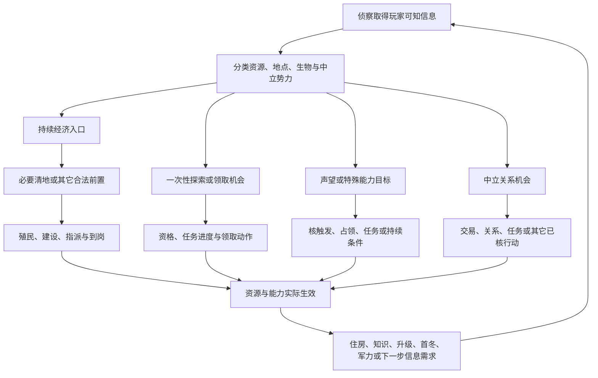

# 从采集器走向运营助手：范围、差距与实施路线

本路线的起点是0.5.2-alpha：已有本人状态采集、已知地图几何、八类自然资源与限定狼熊的读取链及离线检查，新地块组件仍待真实短段验收。完整中立生物、巢穴、遗迹宝藏、声望来源、中立势力和特殊地块是新增覆盖目标，不能因为列入目录就称已经运行时采齐。最新实际支持范围与检查结果分别以[地块详情](KNOWN_ZONE_DETAILS.zh-CN.md)和[验证记录](VALIDATION_STATUS.md)为准。

最终要交付的是：玩家正常玩游戏时，助手能说明**现在先做哪件事、为什么、占用哪些人和资源、何时形成什么能力，以及遇到什么变化后要换计划**。采集数据和解码游戏规则是达到这个结果的基础。

## 1. 地块要表达一组机会与条件

同一块地可以同时有矿藏、野兽、巢穴、一次性物品和通路价值。分别记录这些对象与机制，再按地块和游戏时间连接；不能给地块只贴一个“粮地”“声望地”或“中立地”标签。

| 维度 | 必须表达的问题 | 对玩家决策的影响 |
|---|---|---|
| 持续资源 | 能提供哪些岗位、资源、局部加成；矿物余量和生产入口是什么 | 是否值得殖民、建造和配置工人，是否有替代入口 |
| 即时收益 | 遗迹、沉船、缓存等是否可探索/领取；完成进度、是否已耗用、谁有资格 | 是否值得暂调侦察或军事单位，能否及时补齐下一笔材料 |
| 声望 | 哪个动作或状态触发声望，谁获得、是否一次性、是否已结算 | 能否按时跨过氏族声望门槛，并形成实际能力 |
| 特殊能力 | 知识、治疗、任务、特殊建造或其它能力的前置与持续条件 | 怎样改变发展路线、恢复与行动范围 |
| 威胁 | 现有生物种类和状态、巢穴、生成机制及支持范围 | 清理投入、后续风险与清地顺序；无怪不自动等于永久安全 |
| 通路与空间 | 已知邻接、实际可通行、有效建筑容量、场址与连接条件 | 工人/军队能否按时到场，是否挤占后续关键位置 |
| 中立外交 | 中立势力身份、本人的关系/贸易/任务状态及可用行动 | 是否应交易、等待、绕行或清理，而非默认武力占地 |

这里的“声望地”是一个需要解码的机制集合：**发现、清理、探索、领取、殖民、持续占领、任务和交易可能是不同触发方式**，每一种都要核版本、对象、资格、数量、接收方、次数和结算时点。不能因为名字里有Fame就直接给固定声望。当前配置审查中，`FountainFame`关联Mimirsbrunn的知识用途，正是名称不等于资源语义的例子。

“宝藏”也不能混成一个机制。普通遗迹/沉船、氏族专属缓存和特殊规则目标需要各自的适配器；`Treasure/CursedTreasure`在当前配置中涉及鹰族专属缓存，不能直接当成所有氏族都能领取的通用废墟。

中立势力也不能统一当作“打掉有收益”。当前目录中的九类为`GiantFaction/KoboldFaction/MyrkalfarFaction/LightalfarFaction/DwarfFaction/GayantFaction/MarmennillFaction/OutsidersFaction/KoboldKingFaction`；并非每一类都有可以占领的物理营地。当前配置中消灭矮人的声望项为负值，足以说明清理中立势力不应默认计正收益。具体本局资格、阵营关系和实际结算仍要另核。

## 2. 地图收益有多条兑现路径



图中的分支是待逐类实现的行动模型，并非保证每一种地都支持每一种途径。是否需要殖民、谁能探索或领取，要按地点、氏族与规则分别核验；占下土地也不代表奖励已经领取。例如当前已核默认路径下，普通熊族需先取得遗迹/沉船所在土地；鹰族对这些地点有领土外指派许可，仍受敌意等条件限制。清理一个生物、消除巢穴、获得土地与取得资源是不同事件。中立势力的关系改善也不能直接替代殖民合法性检查。

因此，每个机会都要连接一条可解释的小链：**所需信息 → 行动资格 → 人员/军力与路程 → 付款/劳动/战斗 → 完成条件 → 实际收益或能力 → 后续用途**。缺少哪个环节，就显示该候选缺什么数据，不补一个精确收益或秒数。

## 3. 将四类证据严格分开

| 证据层 | 可以说什么 | 不能升级成什么 |
|---|---|---|
| 本局原生观测 | 此刻记录到某对象、状态、数量、进度或本人关系值 | 完整点击日志、隐藏全图、未来安全、逐人实际到账 |
| 当前版本配置与代码 | 这个对象有哪些候选奖励、默认属性和分支 | 本局已经满足资格、已经领取、所有氏族同样生效 |
| 条件模型与估计 | 在明确工人、加成、路程等条件下的预算或范围 | 原生测量、保证完成时间、通用最优顺序 |
| 玩家经验 | 在某赛制、氏族、地图和队伍职责下的一条路线或解释 | 不带条件的固定规则、跨版本的真实机制 |

这些是资料与数据设计约束，不是宣称当前协议已经有全部相同字段。未来每个对象至少需要保留身份、地块、类型、证据来源、游戏采样时间、可见/知识依据、支持状态和未知原因。缺数据不能用默认奖励回填，后来发现的信息不能倒灌到过去的决策时刻。

“全部”需要一个可检查的分母：从当前安装构建对象目录，并给每类标普通局/氏族限定/规则限定/其它模式，再逐类记录**已识别、字段已解码、离线验证、短段实测、连续窗口验证、多人验证**的实际状态。发现目录中的一种类型，不代表它的状态、奖励与可见性均已实现。

地图覆盖也要分开：探到了多少地、支持哪些对象类别、每类支持哪些字段、当前数据是否可靠。不能用单个“地图完成率”把这四项混在一起。

本轮新增的静态检索入口是：

```powershell
python scripts/inspect_map_catalog.py --summary
python scripts/inspect_map_catalog.py --search Ruins
python scripts/inspect_map_catalog.py --out .local/map-catalog.json
```

命令从本机受支持安装核验双指纹，再生成最小定义目录；不需要开游戏、不读取本局、也不修改游戏文件。可以查询类型、静态奖励线索和中立配置关系，生成文件留在本地。目录中的`catalog_only`与`implemented_not_live_validated`分别表示静态已识别和既有代码已接入但未实局验收，不能把前者算成新增运行时覆盖。配置行总数包含普通玩家建筑/单位以及特殊模式内容，不等于地图中立对象的种类总数。

运行时字段还要逐类解释：`Ruins.state=null`在已核路径中可以是正常探索完成状态，不应当作通用读取失败；`Zone.fameState`的整数也不能直接命名为“声望已经领取”。奖励清单会受领取资格、科技和特殊规则变换，配置奖励只能作为候选参考。

另一个必须补齐的输入是**本人当前声望点数**。目前公共库存只导出粮、木、金、石、铁、知识；`fame_level`来自`me.tech.fameLevel`，是解锁等级缓存，不能反推声望点。当前原生点数入口已经定位为`me.res.resources.map['Fame']`；公共schema、读取和实局校验尚未接入。特殊资源资格或战役分支还可能改变有效值，因此先保留受支持普通局中的原始点数与适用条件，再核奖励归因和200/500等氏族能力门槛。

## 4. 距离原始目标还差什么

| 模块 | 起点已有能力 | 必须补的部分 | 没补齐会造成的错误 |
|---|---|---|---|
| 采集来源与连续性 | 身份、版本双指纹、游戏时钟、分段、错误隔离 | 新组件真实短段与持续窗口；源码来源标签继续完善 | 把测试成功当实局成功，或把旧状态当当前事实 |
| 完整地图内容 | 八类资源、石铁余量、限定狼熊，已知图和基地环层 | 中立生物/巢穴、可消耗地点、声望目标、中立势力与特殊对象逐类适配 | 漏掉开局现金、知识、清地和外交路线 |
| 行动资格与空间 | 几何邻接、本人建筑与部分操作状态 | 真实通路、有效槽位、场址、最终报价、探索/领取/关系行动条件 | 推荐当前根本不能执行的行动 |
| 人口与劳动 | 本人职业、任务、指派、部分输入及转岗阶段 | 生产资格、动态加成、完整增长修正、工作/移动/转职分段校准 | 把职业名当产量，或把到岗前的时间计为收入 |
| 氏族机制 | 普通熊/鸦条件基线和部分知识/能力参考 | 本人声望点、各氏族专属收益、知识、声望门槛与真实费用/时长 | 把解锁等级当声望点，或把同一块地对所有氏族算成同样收益 |
| 方案比较 | 手工提供输入的短期预算比较器 | 自动生成少量合法候选、时间事件预算、信息分支与结果核对 | 只按库存或最少用工排序，漏掉视野、能力与团队价值 |
| 多人协作 | 独立视角、共享标签、脱敏与贡献流程 | 真实3v3、已声明职责与实际交付、共同时间窗和团队外部收益 | 默认队友会清地/开图，或把贡献算给错误的人 |

目前处于“采集与规则研究已有基础，地图内容和可执行条件仍在扩充”的阶段。不能用完成百分比表达距离，因为尚缺共同的对象/分支分母，也没有足够的实局验收。`recommender.py`仍是预算组件，不是自动读取局面并生成策略的完整助手。

达到第一版辅助不必等待找到一份可能并不存在的“逐人原生到账台账”。可以先为输入充分的普通岗位重建限定计算，用隔离场景下的原生汇总与库存变化校准，并给出误差和适用条件；这些始终叫模型估计。住房期限、已知付款缺口等提示也可以先独立验证，不因某个岗位尚未知而让整个助手停摆。

## 5. 以可验里程碑推进

| 里程碑 | 输入与前置 | 输出 | 必须通过的验收 | 仍不承诺 |
|---|---|---|---|---|
| M0：固定采集基线 | 支持的安装指纹、0.5.2或后续明确修订、玩家正常单人局 | 分组件覆盖和错误摘要 | 初始值、暂停、读错、退出、换局不串；新地图短段与界面对照 | 稳定整局、3v3、全字段齐全 |
| M1：完整内容目录 | 当前PAK与针对性原生路径核验 | 地点/生物/势力目录、模式标签、支持矩阵 | 名称与真实类型对应；奖励来源和触发分别列；普通/特殊规则不混 | 目录已列内容都能运行时读取 |
| M2：玩家视角的对象观察 | M1、每类型可见性和owner身份分类、只读适配器 | 已知地上的对象/状态/进度及未知原因 | 未探索不输出；生物与巢穴分开；中立owner不误当普通对手；对象变化和跨局拒绝 | 完整战斗预测、全部奖励到账归因、隐藏信息 |
| M3：机会变成实际收益 | M2、本人任务/库存/声望/关系与原生日志的已核字段 | 探索/清理/领取/殖民/交易的有界事件链 | 开始、完成、领取分别记录；奖励接收方、一次性/持续资格有证据；暂停不加工作量 | 每个鼠标指令、所有同时变化的唯一因果解释 |
| M4：人口与能力预算 | M0–M3、逐类受控场景、明确报价和有效岗位 | 有误差范围的近期资源/人口/能力时间账 | 对未用于校准的窗口核对库存、出生与到岗；跨季节和付款按事件分段 | 永久一人养几人、完整逐人原生实产、全氏族通用模型 |
| M5：有限运营建议 | M4与少量经过复核的氏族阶段模板 | 一项主建议、最多两项替代、成本和翻转条件 | 只看当时信息；缺字段隔离候选；预测与实际结果可回看 | 全局最优、固定开局、自动操作 |
| M6：3v3增量 | 单人支持域先稳、愿意参加者独立采集、多人语义核验 | 团队信息/清地/支援交付及同步能力预算 | 同局标签与时间覆盖检查；职责声明与完成分开；真实3v3短段/整局 | 一机读六人经济、默认队友交付、把单人结果直接认证为团队策略 |

M1静态目录研究可以与M0实测准备并行，M2按常见类型逐批落地，不等待所有特殊模式全部解码。后面的模型和建议只使用已经通过相应验收的输入；未支持的对象应明确显示，不能让整张地图无声缺项。

## 6. 第一批熊族A800–A802场景

以下是验收场景，月份是观察与比较窗口，不是每局强制执行的建造表。按A800的几月与月初/中/末展示，游戏暂停不增加劳动或经济时间。

| 窗口/场景 | 要回答的游戏问题 | 应收集并核对什么 |
|---|---|---|
| A800开局，一环尚未探全 | 两名侦察能解决哪些近期信息缺口，何时可以调回一人 | 侦察任务目标/进度、发现内容、当时已知信息、机会期限；不能用后来的地图替早期决策辩护 |
| A800，发现知识、粮或一次性探索机会 | 先让人口摸知识、取地建岗位，还是暂派侦察完成可领取地点 | 真实类型、可领取资格/进度、殖民与建造前置、原岗位产出损失；按氏族核需要先取地还是有已核例外 |
| A800，资源地有野兽/巢穴 | Kaija能否实际打开所需入口，清完后是否仍有生成风险 | 己方军事能力、对象种类/数量和支持状态、行军/伤势/恢复、巢穴状态；不凭野兽数量给保证胜负 |
| A800，靠近声望目标或中立势力 | 该机会怎样帮助氏族下一段能力，是否应先交易或等待 | 声望触发/接收方/次数、本人关系与行动资格、实际支出和得到的能力；不能按地名直接发奖励 |
| A800人口增长与首冬准备 | 房屋是否及时、宴会/建设/转岗是否挤掉冬季缓冲 | 幸福、进度、容量、实际工种、季节/加成和付款时点；不能只以库存峰值评价宴会 |
| A801升级与第二轮经济 | 矿已够但木/金不足时，哪项建设或调岗造成延期 | 矿余量/到账、材料组合、有效岗位与工人、施工/维护、替代机会，逐笔预算按期限比较 |
| A801–A802继续发展或准备行动 | 何时应把经济转成军力，哪些路线和信息仍不够 | 玩家当前阶段计划、队伍职责、可用现金/人口/战团/装备、路径与到场时间；不从氏族名预设固定角色 |

每个场景先形成可回看的事实链和少数候选，再让熟练玩家补充“为什么当时这样选”和反例。经验标签需要氏族、赛制、当时信息、目标/职责、版本和实际结果；不能只收一句“高手都是这么打”。

## 7. 3v3增加的内容

多人新增的是共同完成任务的解释能力：谁负责开哪条路线、谁清哪块地、谁提供支援、何时需要共同到场。职责是玩家声明与局中调整，不由氏族永久决定。某地来自共享视野时，使用已经取得的信息，但不自动归功于本方侦察员。

清野者可能承担恢复、机会成本和延后经济，收益却由队友殖民后获得。团队比较需要连接“本方投入—实际清地/开图交付—受益方能否及时使用”，不能只按清野者自己的库存算亏赚。缺少队友视角时保留缺失，可使用明确标源的职责声明；不能自行读取其他对战玩家经济补齐。

中立势力的本人关系、已知公共状态与普通玩家经济是不同范围。新增中立读取时必须核原生身份分类和可知规则，不能因为owner非空就全部跳过，也不能为了读中立而放行任意owner对象。

当前原生结构中`Unit.owner`和`Unit.neutralOwner`是不同字段；本人关系入口涉及`me.relations`中的势力引用与共享关系状态。普通中立势力的相遇检查以势力占地与本人已探索集合相交为依据，不能把针对普通玩家的`RelationData.seen`分支当作所有中立势力的闸门。后续适配应从这些已核身份与本人可知条件出发，逐一解释关系、贸易和战争状态；这仍是待实现的读取契约，不表示0.5.2已经导出全部中立关系。

## 8. 交给下一位开发者的执行要求

每次交付选择一组明确对象/分支，提供：目录项和版本证据、最小字段/类型路径、可见性与身份守卫、状态/奖励语义、缺项原因、独立投影与导出校验、可复现实局清单。离线测试包含正例和错误/隐藏/切换/读取竞争反例；对象目录、运行时读取、模型和经验各自保留来源。

每完成一批，先更新[验证记录](VALIDATION_STATUS.md)与支持矩阵，再扩下一批。对用户说明“本轮新增哪种判断能力”，而非只报字段数或用例数。开始给建议前，必须能回到原时刻解释该建议依赖的地图、人口、费用和任务条件。

关联资料：[运营助手设计](OPERATIONS_ADVISOR_DESIGN.zh-CN.md)、[机制研究任务](MECHANICS_RESEARCH_PROGRAM.zh-CN.md)、[机制资料入口](MECHANICS_REFERENCE.zh-CN.md)、[地块详情](KNOWN_ZONE_DETAILS.zh-CN.md)、[游戏数据指南](GAME_DATA_GUIDE.zh-CN.md)、[氏族战略案例](CLAN_STRATEGY_CASES.zh-CN.md)、[多人流程](MULTIPLAYER_3V3.md)。
